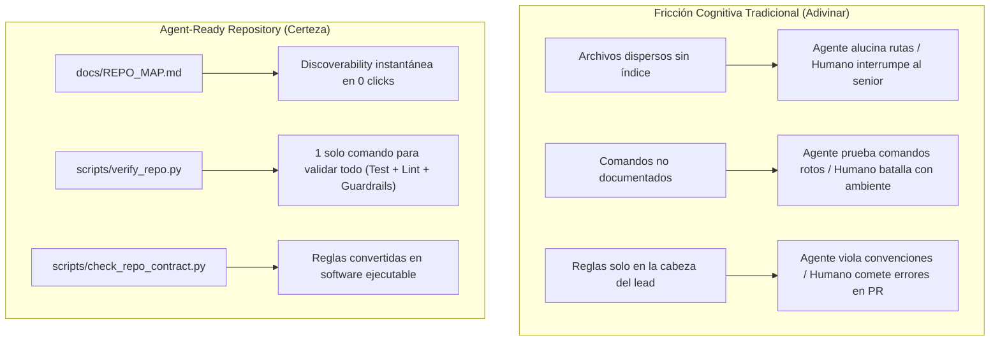

# Análisis de Impacto — Reporte de Mejora en Repository Readiness (ADA-08)

> *"Las mejoras que hacen un repositorio más usable para agentes normalmente también reducen la fricción de nuevos integrantes humanos del equipo. Un agent-ready repository reduce la necesidad de adivinar."*  
> **Contexto para comprender · Discoverability para encontrar · Arquitectura para limitar · Herramientas para ejecutar · Tests y CI para comprobar · Guardrails para prevenir · Evidencia para decidir.**

---

## 1. Filosofía Central: De la Fricción Cognitiva a la Certeza Determinista

En la ingeniería de software asistida por inteligencia artificial, la mayor causa de errores, alucinaciones y demoras no reside en las capacidades de razonamiento del modelo, sino en la **ambigüedad del entorno de trabajo**. Cuando un repositorio depende de "conocimiento tribal", convenciones no escritas o estructuras caóticas, tanto el agente autónomo como un desarrollador novato se ven obligados a adivinar.

Hacer un repositorio *Agent-Ready* no significa llenarlo de prompts extensos ni hiper-optimizar para un LLM específico. Significa aplicar **rigor de ingeniería**:
1. **Contexto para comprender**: Separar requerimientos (`REQUIREMENTS.md`), comportamiento verificable (`SPEC.md`) y diseño estructural (`ARCHITECTURE.md`).
2. **Discoverability para encontrar**: Centralizar un mapa (`docs/REPO_MAP.md`) con enlaces directos a puntos de entrada, pruebas y documentos clave.
3. **Arquitectura para limitar**: Declarar no solo lo que se debe hacer, sino las **fronteras negativas** (lo que *nunca* se debe tocar).
4. **Herramientas para ejecutar**: Sustituir instrucciones verbales por comandos estandarizados e interfaces CLI predecibles (`src/cli.py`).
5. **Tests y CI para comprobar**: Contar con suites automatizadas rápidas y reproducibles (`pytest`) que garanticen cero regresiones.
6. **Guardrails para prevenir**: Convertir reglas en software ejecutable (`scripts/check_repo_contract.py`) en vez de confiar en la buena voluntad del agente.
7. **Evidencia para decidir**: Registrar trazas verificables y objetivas (`results/after-agent-run.md`) que permitan a humanos tomar decisiones informadas.

---

## 2. Tabla Comparativa de Madurez (BEFORE vs AFTER)

A continuación se detalla la evolución del repositorio en cada una de sus dimensiones fundamentales:

| Dimensión | Before | Problema Identificado | Mejora Implementada | After |
|---|:---:|---|---|:---:|
| **Navigation** | 3/5 | `README.md` solo explicaba ejecución básica; no existía un mapa centralizado; las especificaciones dinámicas (`TASK_UNDER_TEST.md`) requerían búsqueda manual o pistas en prompts. | Creación de [`docs/REPO_MAP.md`](file:///D:/IGNITER/Documents/Proyectos/ADA-05-SPEC-DRIVEN/docs/REPO_MAP.md) con índice de puntos de entrada, pruebas, documentos SoT y guías de cambio. Integridad de enlaces validada por guardrail automático. | **5/5** |
| **Instructions** | 3/5 | No existían límites operativos explícitos; el agente intentaba ejecutar comandos git bloqueados por permisos; discrepancias de terminadores CRLF en Windows provocaban fallos en edición. | Implementación de [`AGENTS.md`](file:///D:/IGNITER/Documents/Proyectos/ADA-05-SPEC-DRIVEN/AGENTS.md) con jerarquía SoT (*Read First*), comandos estándar, *Stop Conditions*, regla de preservación de CRLF y prohibición de git no autorizado. Adaptadores limpios ([`GEMINI.md`](file:///D:/IGNITER/Documents/Proyectos/ADA-05-SPEC-DRIVEN/GEMINI.md)). | **5/5** |
| **Build/Test** | 3/5 | `pytest` dependía del entorno Python global sin archivo formal de dependencias; no existía un comando único para compilar, verificar linting y comprobar contratos. | Adición de `requirements.txt` y desarrollo del pipeline determinista unificado [`scripts/verify_repo.py`](file:///D:/IGNITER/Documents/Proyectos/ADA-05-SPEC-DRIVEN/scripts/verify_repo.py) y `verify_repo.sh` (Tests + Lint + Guardrails). | **5/5** |
| **Architecture** | 3/5 | Capas documentadas pero sin límites negativos formales; riesgo de que el agente modificara archivos de persistencia, secretos o especificaciones protegidas. | [`ARCHITECTURE.md`](file:///D:/IGNITER/Documents/Proyectos/ADA-05-SPEC-DRIVEN/ARCHITECTURE.md) complementado con sección *Do Not Edit Directly* en `REPO_MAP.md` y salvaguardas de persistencia desacoplada en [`src/customer_repository.py`](file:///D:/IGNITER/Documents/Proyectos/ADA-05-SPEC-DRIVEN/src/customer_repository.py). | **5/5** |
| **Traceability** | 4/5 | Requerimientos (`FR-`, `NFR-`) y criterios de aceptación (`AC-`) existían en `SPEC.md`, pero su verificación de cobertura era manual y no había trazabilidad automatizada. | Matriz completa de trazabilidad conectada en código y suite de pruebas (`test_search_service.py`), verificada automáticamente por [`scripts/check_repo_contract.py`](file:///D:/IGNITER/Documents/Proyectos/ADA-05-SPEC-DRIVEN/scripts/check_repo_contract.py) en cada corrida. | **5/5** |
| **Guardrails** | 1/5 | Dependencia exclusiva de instrucciones en lenguaje natural ("no toques spec", "no pongas secretos"). Ausencia de validadores ejecutables de contrato de repositorio. | Desarrollo de [`scripts/check_repo_contract.py`](file:///D:/IGNITER/Documents/Proyectos/ADA-05-SPEC-DRIVEN/scripts/check_repo_contract.py) con 7 guardrails automáticos en software (archivos esenciales, trazabilidad, comandos AGENTS, escáner de secretos, REPO_MAP, JSON semilla y contratos de adaptadores) con tests propios. | **5/5** |
| **Tests/Evidence** | 4/5 | Suite de pruebas existente (61 pruebas), pero sin medición de contrato ni validación formal de cambios incrementales; recolección de evidencia dependiente de pasos manuales. | Suite ampliada a 77 pruebas automáticas (100% PASS en ~0.21s), cobertura para `CR-01` (`test_search_field_*`), generación estandarizada de evidencia reproducible en `results/`. | **5/5** |
| **Safety** | 2/5 | Sin escaneo de secretos; comandos git no acotados causaban pausas por solicitud de permisos al usuario; ausencia de protección sobre archivos `.env` o specs. | Escáner regex de credenciales/tokens en código fuente; *Negative boundaries* explícitos; prohibición formal de comandos git destructivos o de inspección de estado. | **5/5** |

---

## 3. Impacto en Nuevos Integrantes Humanos vs Agentes Autónomos

El paralelismo entre la experiencia de un desarrollador humano que se incorpora al equipo (*onboarding*) y la de un agente autónomo de IA es directo:



### Casos Concretos de Reducción de Fricción:
1. **Onboarding en 2 minutos en lugar de 2 días**: Un nuevo ingeniero no necesita preguntar "¿cómo corro los tests?", "¿dónde está el endpoint?" o "¿qué archivos puedo tocar?". `AGENTS.md` y `docs/REPO_MAP.md` responden exactamente eso en menos de una página.
2. **Eliminación del "En mi máquina funciona"**: El script `scripts/verify_repo.py` establece una verdad reproducible. Si pasa localmente, pasará en CI y pasará para el agente.
3. **Seguridad psicológica al refactorizar**: Los 7 guardrails de `check_repo_contract.py` impiden que un error humano o de IA borre por accidente un archivo de contrato, introduzca credenciales hardcodeadas o rompa la trazabilidad de requerimientos.

---

## 4. Reflexión Individual (13 Preguntas Fundamentales)

### 1. ¿Cuál fue el principal obstáculo para el agente en la ejecución BEFORE?
El principal obstáculo fue la **ausencia de límites operativos y contratos de entorno explícitos**. El agente asumió terminadores de línea Unix (`\n`) sobre archivos que en Windows utilizaban CRLF (`\r\n`), provocando fallos en herramientas de edición de texto. Asimismo, la falta de una regla negativa sobre comandos git lo llevó a invocar `git status`, deteniendo la ejecución al solicitar permisos al usuario. Finalmente, la falta de un comando unificado obligó a inferir cómo validar el proyecto.

### 2. ¿Qué información tuvo que inferir el agente que un desarrollador experimentado ya conocía?
Un desarrollador senior del proyecto ya sabía de forma tácita:
- Que `src/customers.json` funcionaba como persistencia en memoria y no debía ser modificada durante búsquedas.
- Que en sesiones de asistencia automatizada no se deben ejecutar comandos de historial o estado de git.
- Que ante una solicitud de cambio activa (`CR-01`), `TASK_UNDER_TEST.md` toma precedencia operativa sobre el backlog histórico `TASKS.md`.
- Que el entorno local corría sobre Windows y requería respetar los terminadores CRLF para evitar diffs corruptos.

### 3. ¿Qué mejora produjo el mayor impacto y por qué?
La combinación de **`docs/REPO_MAP.md` junto con `scripts/verify_repo.py`**. `REPO_MAP.md` eliminó por completo la exploración a ciegas, permitiendo al agente saltar directamente a los archivos involucrados (`src/search_services.py`, `src/handler.py`, `src/cli.py`, `test/test_search_service.py`). Por su parte, `verify_repo.py` condensó tres pasos críticos (pytest, compileall, guardrails) en una sola llamada determinista con retroalimentación binaria (PASS/FAIL).

### 4. ¿Qué información pertenece en AGENTS.md y qué información NO debería vivir ahí?
- **Pertenece en `AGENTS.md`**: Jerarquía de lectura y fuentes de verdad (*Sources of Truth*), comandos estándar reproducibles (Install, Run, Test, Lint, Verify), límites de cambio, condiciones de parada (*Stop Conditions*), reglas operativas del entorno (CRLF, restricciones de git) y la Definición de Terminado (*Definition of Done*).
- **NO debe vivir en `AGENTS.md`**: Requerimientos de negocio (pertenecen a `REQUIREMENTS.md`), especificaciones técnicas o modelos de dominio detallados (pertenecen a `SPEC.md`), descripciones arquitectónicas y flujos de datos (pertenecen a `ARCHITECTURE.md`), ni fragmentos de código duplicados que generen divergencias ante cambios futuros.

### 5. ¿Qué regla convertiste en software/hook/script en lugar de dejarla como instrucción?
La verificación de **integridad contractual del repositorio**. En lugar de pedirle al agente en lenguaje natural *"asegúrate de que no haya secretos, que existan los archivos obligatorios, que los IDs de requerimientos sigan en SPEC.md y que no se rompan enlaces"*, se implementó [`scripts/check_repo_contract.py`](file:///D:/IGNITER/Documents/Proyectos/ADA-05-SPEC-DRIVEN/scripts/check_repo_contract.py). Este script valida deterministamente mediante Python y expresiones regulares:
1. Existencia y tamaño de archivos esenciales.
2. Presencia de IDs de requerimientos (`FR-01`..`FR-06`, `NFR-01`..`NFR-02`, `AC-01`..`AC-06`).
3. Comandos estándar en `AGENTS.md`.
4. Escaneo de patrones de tokens/claves privadas.
5. Integridad de rutas referenciadas en `docs/REPO_MAP.md`.
6. Formato JSON, conteo $\ge$ 50 y unicidad de emails en `src/customers.json`.
7. Delegación de adaptadores (`GEMINI.md`, `CLAUDE.md`).
Además, este guardrail está respaldado por pruebas automatizadas en `test/test_check_repo_contract.py`.

### 6. ¿Qué diferencia observaste entre 'más contexto' y 'mejor contexto'?
- **'Más contexto'**: Saturar el prompt o el repositorio con documentación redundante, volcados de logs y directivas contradictorias. Provoca sobrecarga cognitiva, mayor consumo de tokens, aumento de latencia y riesgo de alucinación o distracción hacia tareas no prioritarias.
- **'Mejor contexto'**: Información modular, estructurada y jerarquizada con un punto de inicio único, enlaces de navegación directos (`docs/REPO_MAP.md`), delimitación negativa de lo que NO se debe hacer y comandos deterministas ejecutables. Guía al agente con precisión quirúrgica sin desperdiciar tokens.

### 7. ¿Qué riesgo aparece cuando CLAUDE.md/GEMINI.md/copilot instructions duplican información del proyecto?
Aparece el riesgo crítico de **desincronización y divergencia ("split-brain")**. Si una instrucción, comando o regla cambia en el proyecto pero solo se actualiza en uno de los archivos de instrucciones, los distintos agentes o modelos operarán bajo supuestos inconsistentes y contradictorios, violando el principio de *Single Source of Truth* (SSoT). La arquitectura de adaptadores adoptada resuelve esto haciendo que `GEMINI.md` y `CLAUDE.md` deleguen explícitamente en `AGENTS.md` sin duplicar texto.

### 8. ¿Qué checks comparten ahora el agente, el desarrollador humano y CI?
Comparten exactamente el mismo contrato ejecutable:
```bash
python scripts/verify_repo.py
```
El cual ejecuta en secuencia determinista:
1. **Pruebas unitarias y de integración**: `pytest -q` (77 pruebas automáticas).
2. **Linting y análisis sintáctico**: `python -m compileall -q src test scripts`.
3. **Guardrails de contrato**: `python scripts/check_repo_contract.py` (7 validaciones automatizadas).

### 9. ¿Qué parte del proceso sigue requiriendo decisión humana?
El **juicio de valor y la definición de negocio**:
- Definición de nuevas necesidades y prioridades del usuario final.
- Modificación o creación de especificaciones en `REQUIREMENTS.md` y `SPEC.md`.
- Decisiones arquitectónicas fundamentales (e.g. migrar de persistencia en memoria a un motor distribuido).
- Evaluación ética, regulatoria y de privacidad sobre clasificación de datos sensibles.
- Autorización final de despliegue a producción (*Human Gate*).

### 10. ¿Qué evidencia demuestra que el AFTER es realmente mejor?
La evidencia es cuantitativa y observable:
- **Comandos fallidos**: Reducidos de **3 en BEFORE a 0 en AFTER**.
- **Suposiciones incorrectas**: Reducidas de **3 en BEFORE a 0 en AFTER**.
- **Preguntas de aclaración**: **0 requeridas** (autonomía informada).
- **Cobertura de pruebas**: Incremento de **61 a 77 pruebas automáticas pasando al 100% en ~0.21s**.
- **Guardrails de contrato**: 7/7 guardrails automáticos verificados sin fallos.
- **Puntuación de madurez del repositorio**: Aumento de **59.0 / 100 a 100.0 / 100 (+41.0 puntos)** bajo la misma rúbrica y pesos.

### 11. ¿Qué mejora realizada para el agente también beneficia a un desarrollador que entra por primera vez al proyecto?
[`docs/REPO_MAP.md`](file:///D:/IGNITER/Documents/Proyectos/ADA-05-SPEC-DRIVEN/docs/REPO_MAP.md) y [`scripts/verify_repo.py`](file:///D:/IGNITER/Documents/Proyectos/ADA-05-SPEC-DRIVEN/scripts/verify_repo.py). El desarrollador recién llegado sabe instantáneamente dónde está el código de negocio, dónde están las pruebas, qué archivos están protegidos y cómo verificar con total certeza que su cambio no introdujo regresiones, sin tener que consultar a ningún compañero de equipo.

### 12. ¿Qué variable no controlada podría afectar tu comparación BEFORE/AFTER?
- Variaciones estocásticas inherentes a los modelos de lenguaje (muestreo probabilístico, temperatura).
- Diferencias de estado de caché entre ejecuciones (archivos precompilados `.pyc`, caché de pytest).
- Posible contaminación de contexto si el prompt posterior contiene detalles involuntarios no presentes en el inicial.

### 13. ¿Qué elementos de este ADA conservarás como base para tu proyecto final?
1. El archivo central [`AGENTS.md`](file:///D:/IGNITER/Documents/Proyectos/ADA-05-SPEC-DRIVEN/AGENTS.md) estructurado con *Read First*, *Sources of Truth*, *Standard Commands*, *Change Rules*, *Stop Conditions* y *Definition of Done*.
2. El mapa centralizado de navegación [`docs/REPO_MAP.md`](file:///D:/IGNITER/Documents/Proyectos/ADA-05-SPEC-DRIVEN/docs/REPO_MAP.md) con boundaries negativos explícitos.
3. El script determinista de verificación [`scripts/verify_repo.py`](file:///D:/IGNITER/Documents/Proyectos/ADA-05-SPEC-DRIVEN/scripts/verify_repo.py) para unificar la validación en local y en CI.
4. El validador automatizado de guardrails [`scripts/check_repo_contract.py`](file:///D:/IGNITER/Documents/Proyectos/ADA-05-SPEC-DRIVEN/scripts/check_repo_contract.py) para convertir contratos y políticas de seguridad en software ejecutable.
5. El desacoplamiento estricto de adaptadores específicos de agente (`GEMINI.md`, `CLAUDE.md`) que deleguen sin duplicar.
